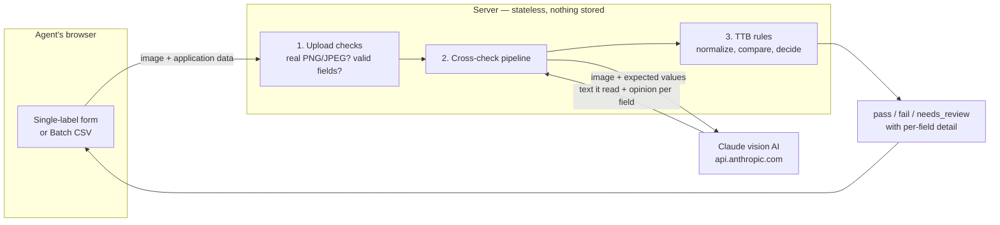

# TTB Label Verifier

A prototype that helps TTB compliance agents check alcohol label artwork against the application data it is supposed to match. An agent submits a label image and the declared values (brand name, class/type, alcohol content, net contents, and optionally producer and country of origin); the app reads the label with AI, applies TTB rules, and returns **pass**, **fail**, or **needs_review** with a per-field breakdown.

It is decision support only: it never approves or rejects an application on its own, and anything uncertain is routed to a human. Nothing is stored — images and application data are processed in memory and discarded.

**Live demo:** [https://ttb-label-verifier-eta.vercel.app/](https://ttb-label-verifier-eta.vercel.app/)

## Quick start

Requires Node.js 20.9+.

```bash
git clone https://github.com/Jransom33/TTB_label_verifier.git
cd TTB_label_verifier
npm install
cp .env.example .env.local   # then set ANTHROPIC_API_KEY and ANTHROPIC_MODEL
npm run dev                  # http://localhost:3000
```

`ANTHROPIC_MODEL` must be a Claude model that accepts images and structured outputs (e.g. a current Sonnet). The only outbound network call is `api.anthropic.com:443`; allow that path through any firewall.

Everything is used through the web UI at `http://localhost:3000` — there is no need to call the API directly. Sample labels are bundled, so no files of your own are required:

- **Single label** — click one of the example labels to load its image and application values (or upload your own and fill in the form), then submit. The result shows the overall outcome and, for every field, the expected value, what was read from the label, a color-coded status, and an explanation for anything that isn't a clean match.
- **Batch CSV** — click *Try an example batch* to run six applications at once, including deliberate mismatches, or supply your own CSV and images (format below).

Other commands:

```bash
npm test        # all tests run offline — the Anthropic SDK is mocked, no key needed
npm run lint
npm run build
```

Optional environment limits: `MAX_IMAGE_BYTES` (default 10 MB) and `MAX_REQUEST_BYTES` (default image limit + 1 MB).

## How it works




What happens to a submission, step by step:

1. **The upload is checked first.** The server confirms the file really is a PNG or JPEG within size limits and that the application data is complete and well-formed. Bad requests get a plain-language error here, before any AI is involved.
2. **The AI reads the label.** The image and the expected values go to Claude, which reports, for each field, the text it saw, or that the field was *missing* from the label or *unreadable* (glare, blur, angle). It never invents text it cannot read, and it is never asked about fields the application did not supply. For each field it could read, it also gives an opinion: does this mean the same thing as what the application declared? That opinion is how equivalent formats like "90 Proof" vs "45% Alc./Vol." are recognized without conversion tables in code.
3. **Our code makes the final call.** Deterministic rules (not the AI) decide each field's status. If the two values are identical after ignoring harmless differences (capitalization, punctuation, spacing), it's a **match**, even if the AI disagreed. If they differ but the AI judged them equivalent, it's **needs_review** so a human can confirm. If the AI judged them different, it's a **mismatch**. The government warning has its own stricter rule (below).
4. **Field results roll up into one outcome.** Any confirmed problem → **fail**. Otherwise any uncertainty → **needs_review**. Only when every field confidently matches → **pass**. A low-confidence reading is never allowed to decide the outcome on its own.
5. **The result returns to the browser.** Every field's expected value, extracted value, status, confidence, and explanation come back in one response, so an agent sees all problems at once. The server keeps no copy; the only log line is timing and outcome metadata.

For a deeper walkthrough of the server design, see [architecture.md](architecture.md).

### Worked examples


| Application says           | Label shows                                         | Result                                | Why                                                                                                                                              |
| -------------------------- | --------------------------------------------------- | ------------------------------------- | ------------------------------------------------------------------------------------------------------------------------------------------------ |
| `STONE'S THROW`            | `Stone's Throw`                                     | match                                 | Capitalization and punctuation differences are ignored.                                                                                          |
| `45% Alc./Vol. (90 Proof)` | `90 Proof`                                          | needs_review                          | The AI judges them equivalent, but the text is not identical, so a human confirms.                                                               |
| `750 mL`                   | `700 mL`                                            | mismatch → overall **fail**           | The values genuinely disagree.                                                                                                                   |
| Warning present            | Heading printed `Government Warning:` in title case | mismatch → overall **fail**           | The heading must be exactly `GOVERNMENT WARNING:` in caps and bold; the body wording must be exact (letter case ignored, line wrapping ignored). |
| `producer` supplied        | Glare makes it illegible                            | unreadable → overall **needs_review** | The app never guesses; it asks a human instead.                                                                                                  |
| `producer` omitted         | Anything                                            | not checked                           | Optional fields are only verified when supplied.                                                                                                 |


### Terminology


| Term             | Meaning                                                                                                                                                 |
| ---------------- | ------------------------------------------------------------------------------------------------------------------------------------------------------- |
| Application data | The values the applicant declared on their form (what the label *should* say)                                                                           |
| Evidence         | What the AI scan reports for one field: the text it read (*readable*), nothing found on the label (*missing*), or present but illegible (*unreadable*). |
| Verdict          | The AI's opinion on a readable field — `match` or `mismatch` against the expected value. An input to our rules, never the final answer.                 |
| Status           | The final per-field answer, decided by code: `match`, `needs_review`, `mismatch`, `missing`, or `unreadable`.                                           |
| Outcome          | The whole-label answer derived from the statuses: `pass`, `fail`, or `needs_review`.                                                                    |
| Confidence       | `low` / `medium` / `high`, self-reported by the model. Low confidence is never decisive (i.e. won't result in pass or fail, only needs_review).         |
| Scan             | One AI call: image and expected values in, evidence and verdicts out.                                                                                   |


## Batch mode

During peak season importers file hundreds of labels at once, so the UI accepts a CSV of applications plus the matching label images (up to 300 rows). The browser pairs each row to an image by **exact filename** and calls the same single-verification endpoint once per row, four at a time — there are no separate batch endpoints, so the server stays stateless and retrying failed items is always safe.

The CSV needs a header row with these columns in any order (`producer` and `countryOfOrigin` may be blank):

```csv
imageFile,brandName,classType,alcoholContent,netContents,producer,countryOfOrigin
Tenuta_wine.png,TENUTA BELMONTE,Chianti Classico,13.5% Alc./Vol.,750 mL,"Tenuta Belmonte S.R.L., Greve in Chianti, Italy",Italy
old_toms_distillery.png,OLD TOM DISTILLERY,Kentucky Straight Bourbon Whiskey,45% Alc./Vol. (90 Proof),750 mL,,
```

Alongside that CSV you would select `Tenuta_wine.png` and `old_toms_distillery.png` as the image files. A full working sample is bundled: `[public/batch-test.csv](public/batch-test.csv)` pairs with the images in `[examples/](examples/)`, and the *Try an example batch* button loads both automatically.

Invalid rows are reported by spreadsheet row number without blocking the rest; unmatched rows and unused images are flagged before the run starts. The UI shows live progress, per-item results, a pass/fail/review/error summary, and a retry button for failed items only.

## API reference

The UI is the intended interface; these are the two endpoints it calls, documented for developers. Both return JSON with a `requestId` (also in the `x-request-id` header).

- `**GET /api/health**` — availability check only, no provider details. Returns `{ "data": { "status": "ok" }, "requestId": … }`.
- `**POST /api/verifications**` — `multipart/form-data` with exactly one file field `image` (`.png` / `.jpg` / `.jpeg`) and one text field `applicationData` (JSON with required `brandName`, `classType`, `alcoholContent`, `netContents`; optional `producer`, `countryOfOrigin`). Returns `{ "data": { "outcome", "fields" }, "requestId" }`, where each entry in `fields` carries `expected`, `extracted`, `status`, `confidence`, and `explanation` — exactly what the UI displays.

Failures use `{ "error": { "code", "message" }, "requestId" }`, which the UI surfaces as plain-language messages:


| Code                     | Status | When                                                                       |
| ------------------------ | ------ | -------------------------------------------------------------------------- |
| `INVALID_REQUEST`        | 400    | Missing/extra fields, invalid application JSON, or a corrupt image         |
| `PAYLOAD_TOO_LARGE`      | 413    | Image or request exceeds the configured limit                              |
| `UNSUPPORTED_MEDIA_TYPE` | 415    | Not multipart, or not a PNG/JPEG whose bytes match the declared type       |
| `PROVIDER_UNAVAILABLE`   | 503    | The AI service is down                                                     |
| `PROVIDER_TIMEOUT`       | 504    | The AI took too long (hard abort at 10s, one retry for transient failures) |
| `INTERNAL_ERROR`         | 500    | Unexpected failure (details never leak to the client)                      |


Each verification logs exactly one JSON line — request ID, total duration, scan duration, outcome, and public error code. Images, application data, secrets, and raw provider payloads are never logged.

## Project structure


| Path                       | What it does                                                                                                                                                                                      |
| -------------------------- | ------------------------------------------------------------------------------------------------------------------------------------------------------------------------------------------------- |
| `app/`                     | Next.js pages and API routes: the web UI (`page.tsx`), `GET /api/health`, and `POST /api/verifications` (the composition point that wires everything together).                                   |
| `components/`              | Browser UI: single-label form, results display, bundled examples, and batch mode (`batch-verification.tsx`, CSV parsing in `parse-batch-csv.ts`, the 4-worker pool in `run-with-concurrency.ts`). |
| `server/`                  | HTTP plumbing: upload validation (`verification-request.ts`) and error envelopes / request IDs (`http.ts`).                                                                                       |
| `domain/`                  | The TTB rulebook in plain TypeScript with no outside dependencies: application schema, warning wording (versioned), text normalizers, per-field matching rules, and the overall-outcome rule.     |
| `usecases/`                | `cross-check-label.ts`, the single pipeline both single and batch verification share, plus the `ports/` interfaces it depends on (`LabelScanner`, `Telemetry`).                                   |
| `adapters/`                | Swappable implementations of those interfaces: the live Claude vision scanner, offline stub scanners for tests, and console telemetry. Only code here knows Anthropic exists.                     |
| `examples/`                | Sample label images bundled into the UI.                                                                                                                                                          |
| `public/batch-test.csv`    | Sample batch CSV that pairs with the example images.                                                                                                                                              |
| `docs/`, `architecture.md` | Detailed requirements, the decision log ([docs/spec.md](docs/spec.md)), and a deeper architecture walkthrough with sequence diagrams ([architecture.md](architecture.md)).                        |
| `*.test.ts`                | Tests live next to the code they cover and all run offline.                                                                                                                                       |


File by file (tests omitted — each `*.test.ts` covers its neighbor):

`app/`

- `layout.tsx` — root HTML shell, fonts, page metadata
- `page.tsx` — home page with single/batch mode toggle
- `api/health/route.ts` — availability check endpoint
- `api/verifications/route.ts` — label verification endpoint wiring scanner, telemetry, pipeline

`components/`

- `label-verification-form.tsx` — single-label form: image, fields, submit
- `label-image-upload.tsx` — drag-and-drop image picker with client checks
- `label-examples.tsx` — bundled sample labels with application values
- `verification-results.tsx` — renders the outcome and per-field results
- `batch-verification.tsx` — batch mode: pairing, progress, summary, retry
- `parse-batch-csv.ts` — parses and validates the batch CSV
- `run-with-concurrency.ts` — runs verification requests four at a time

`server/`

- `verification-request.ts` — validates the multipart upload and image bytes
- `http.ts` — public error codes, response envelopes, request IDs

`domain/`

- `application.ts` — application-data schema and JSON parsing
- `extracted-label.ts` — evidence and confidence types for scans
- `verification-rules.ts` — warning wording and field comparison strategies
- `normalizers.ts` — text cleanup used only for comparison
- `field-matchers.ts` — decides each field's final status
- `overall-outcome.ts` — folds field statuses into one outcome
- `verification.ts` — public result types the API returns

`usecases/`

- `cross-check-label.ts` — the pipeline: scan, match, derive outcome
- `ports/label-scanner.ts` — interface every label scanner implements
- `ports/telemetry.ts` — interface for the sanitized metrics log

`adapters/`

- `vision-label-scanner.ts` — live Claude call with timeout, retry
- `vision-label-response.ts` — validates Claude's structured reply
- `stub-label-scanner.ts` — test scanner echoing application values
- `unread-label-scanner.ts` — offline fallback reporting everything unreadable
- `console-telemetry.ts` — logs one sanitized JSON line per verification API call (prevents sensitive label data from being logged)


## Approach and tools

The design separates two jobs: **the AI reads; the code decides.** Claude extracts label text and offers an equivalence opinion, but every status and the overall outcome come from deterministic, tested rules in `domain/`. That keeps behavior explainable and biased toward human review — an AI opinion alone can escalate a field to review, but it can never single-handedly pass or fail one that the rules see differently.

The layering follows the dependency rule (adapters → use cases → domain, never the reverse). The AI sits behind a `LabelScanner` interface, so if the target network blocks Anthropic — a real risk flagged by IT — the provider can be swapped by changing one adapter without touching any rule.


| Tool                                           | Why                                                                                                                               |
| ---------------------------------------------- | --------------------------------------------------------------------------------------------------------------------------------- |
| Next.js (App Router) + TypeScript + React      | UI and API in one small deployable; types enforce the domain contracts (e.g. a field that was never read cannot carry a verdict). |
| Anthropic Claude (vision + structured outputs) | Reads labels and judges equivalence; replies are schema-validated so a malformed answer never reaches the rules.                  |
| Zod                                            | Validates application JSON and AI replies against one shared schema each.                                                         |
| sharp                                          | Fully decodes every upload, so disguised or corrupt files are rejected early.                                                     |
| Papa Parse                                     | CSV parsing in the browser for batch mode.                                                                                        |
| Vitest                                         | Test runner; the Anthropic SDK is mocked so the whole suite runs offline.                                                         |
| Tailwind CSS                                   | Styling.                                                                                                                          |


## Assumptions

- `classType` is the class/type designation as printed on the label (e.g. `Kentucky Straight Bourbon Whiskey`).
- `producer` and `countryOfOrigin` are optional and verified only when supplied; omitting them never invalidates a request.
- Government warning rule (versioned as `v1`): a bold, all-caps `GOVERNMENT WARNING:` heading followed by the standard wording. Line wrapping is ignored; body wording, numbering, and punctuation must be exact but body letter case is not; correct wording under a non-bold heading is a mismatch; wording correct but boldness unreadable is needs_review.
- Code performs no unit or numeric conversion. ABV/proof and volume-unit equivalence is the AI's judgment, and equivalent-but-not-identical values always go to human review rather than auto-passing.
- Confidence labels are the model's own categories, not calibrated probabilities; they are treated conservatively (low is never decisive).
- Uploads are fully decoded with a 25-megapixel cap and a 10 MB default size limit; corrupt or truncated images return `INVALID_REQUEST` (400), not `UNSUPPORTED_MEDIA_TYPE` (415).
- Typical single-label results target roughly 5 seconds (the stakeholder usability threshold); the 10-second provider timeout is a hard abort, not that target. Both durations are measured separately in the log line.
- The server is stateless with no persistence, so batch orchestration lives in the browser and retrying any item is idempotent.
- `GET /api/health` means application availability only, not AI-provider readiness.


## Known limitations

- Requires outbound access to `api.anthropic.com:443`; on a network that blocks it, verifications degrade to a clear 503 rather than wrong answers.
- Confidence is not calibrated against a measured accuracy target; representative accuracy benchmarking is future work.
- Poor image quality is handled by routing unreadable fields to human review rather than by giving specific guidance (e.g. "reduce glare").
- Deliberately out of scope per the brief: COLA integration, user accounts/authentication, durable storage, and autonomous approval or rejection.
- `classType` of alcohol is not verified from among the acceptable value from TTB.

