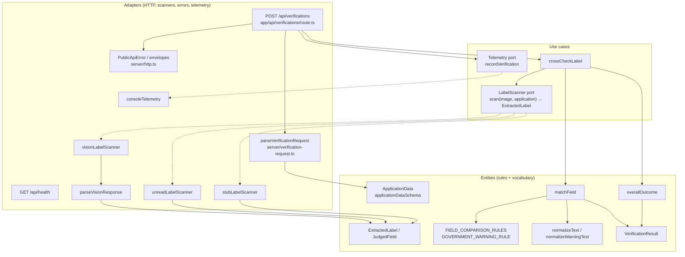
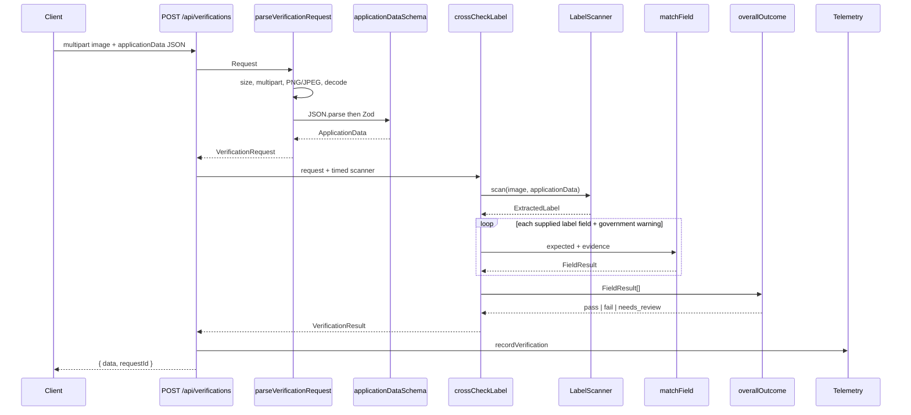
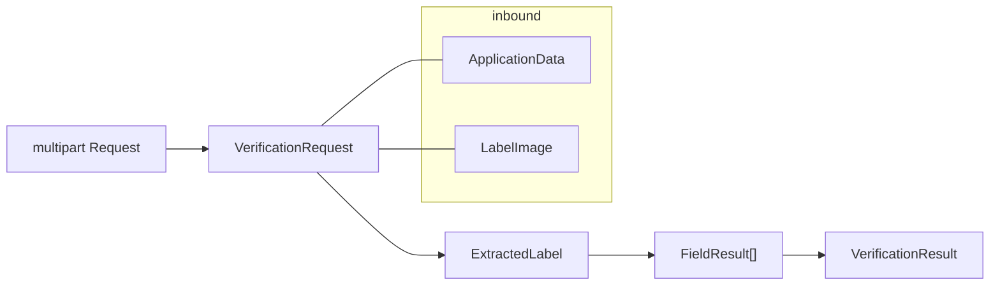
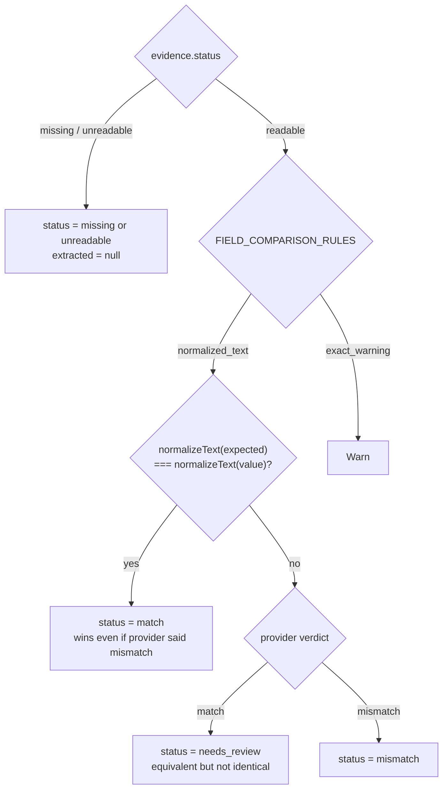

# Architecture

Stateless Next.js backend that compares one alcohol label image to application data and returns a structured verdict. Nothing is persisted. Uncertain results go to human review; the service never autonomously approves or rejects a COLA.

Dependencies only point inward: adapters know about use cases, use cases know about domain types, domain imports nothing outside `domain/`.

The live route injects `visionLabelScanner` and `consoleTelemetry`. Tests drive the pipeline with `stubLabelScanner` and keep `unreadLabelScanner` as an offline fallback.

---

## Request path

A thrown `PublicApiError` (or subclass) becomes `{ error: { code, message }, requestId }`. Anything else becomes `INTERNAL_ERROR`. Stack traces, image bytes, and full application data never leave the error presenter. The same mapping (`toApiErrorCode`) is what telemetry records as `errorCode`.

---

## Layers and files

| Layer | Owns | Files |
| --- | --- | --- |
| HTTP adapter | Parse, request IDs, envelopes, composition | `app/api/verifications/route.ts`, `app/api/health/route.ts`, `server/verification-request.ts`, `server/http.ts` |
| Use case | One verification, no HTTP, no vendor | `usecases/cross-check-label.ts` |
| Port | Need, not technology | `usecases/ports/label-scanner.ts` (`LabelScanner`, `LabelImage`), `usecases/ports/telemetry.ts` (`Telemetry`, `VerificationEvent`) |
| Scanner adapters | Prompts, SDKs, stubs, provider-output validation | `adapters/unread-label-scanner.ts`, `adapters/stub-label-scanner.ts`, `adapters/vision-label-scanner.ts`, `adapters/vision-label-response.ts` |
| Telemetry adapter | One sanitized JSON log line | `adapters/console-telemetry.ts` |
| Domain | Types, TTB rules, matching, outcome | `domain/application.ts`, `domain/extracted-label.ts`, `domain/verification.ts`, `domain/verification-rules.ts`, `domain/normalizers.ts`, `domain/field-matchers.ts`, `domain/overall-outcome.ts` |

`LabelImage` lives on the port so the upload guard and the scanner share one shape. The route is the only composition point: it chooses which `LabelScanner` and `Telemetry` to inject. It times the whole request (`durationMs`) and the provider `scan` (`scanDurationMs`) so provider latency can be compared to the five-second typical-result target without aborting at five seconds. The provider timeout is 10s.

---

## Types: what each object is for

**`ApplicationData`** — declared values from the form JSON. Required: `brandName`, `classType`, `alcoholContent`, `netContents`. Optional: `producer`, `countryOfOrigin`. `classType` is the designation on the label.

**`LabelImage`** — trusted in-memory bytes plus `image/jpeg` or `image/png`. Filename is discarded after validation.

**`ExtractedLabel`** — what a scanner saw, not a verdict for the client.

- `fields`: a total `Record<LabelField, JudgedField>`. Every key exists even if the application omitted an optional.
- `governmentWarning`: three evidence pieces (`heading`, `text`, `headingIsBold`). Boldness is visual evidence, not a provider match/mismatch verdict.

**`JudgedField`** — evidence plus, when readable, a `FieldVerdict` (`match` | `mismatch`). TypeScript forbids a verdict on `missing` / `unreadable` evidence, so a field that was never read cannot be judged.

**`FieldResult`** — public per-field row: `expected`, `extracted`, `status`, `confidence`, `explanation`. Reported strings are the originals; normalized copies are comparison-only and never returned.

**`VerificationResult`** — `outcome` plus the field list. Outcome is derived from statuses and confidences only, never from label text.

Field-name unions:

- `LabelField` — the six application-backed keys (`brandName` … `countryOfOrigin`)
- `VerificationField` — those six plus `governmentWarning`

---

## Where validation happens

Validation is split on purpose. The HTTP guard rejects bad *requests*. The vision adapter rejects bad *provider replies*. The matchers decide whether two *values* agree. They are not the same job.

### 1. Upload guard — `server/verification-request.ts`

Runs before the use case and before any scanner. Failures are `RequestValidationError` → public HTTP codes.

| Check | Failure |
| --- | --- |
| `Content-Type` is `multipart/form-data` | `UNSUPPORTED_MEDIA_TYPE` (415) |
| Body size vs `MAX_REQUEST_BYTES` (default image limit + 1 MB) | `PAYLOAD_TOO_LARGE` (413) |
| Exactly one `image` file and one `applicationData` text field | `INVALID_REQUEST` (400) |
| Extension `.png` / `.jpg` / `.jpeg`, MIME matches extension | `UNSUPPORTED_MEDIA_TYPE` |
| File size vs `MAX_IMAGE_BYTES` (default 10 MB); empty files | 413 / 400 |
| PNG/JPEG magic bytes match the declared type | `UNSUPPORTED_MEDIA_TYPE` |
| Full decode via sharp, 25 megapixel cap | `INVALID_REQUEST` |

### 2. Application JSON schema — `domain/application.ts`

`parseApplicationData` JSON-parses the form field, then `applicationDataSchema.safeParse`. The schema lives in domain so HTTP and tests share one contract.

- `strict()`: unknown keys rejected
- strings trimmed; blanks rejected; max lengths enforced
- `producer` and `countryOfOrigin` optional, but if present they must be non-blank

Malformed JSON and schema failures both become `INVALID_REQUEST`. No field-level error details are returned.

### 3. Provider output — `adapters/vision-label-response.ts`

`visionOutputFormat` is the Anthropic structured-output schema. `parseVisionResponse` then enforces domain invariants the JSON schema cannot:

- Zod shape: statuses, confidence categories, verdicts, warning evidence
- readable evidence must have a non-blank value and a verdict
- missing/unreadable evidence must have `value: null` and `verdict: null`
- exactly the fields the application supplied, no extras, no duplicates
- omitted optionals are filled as `missing` so `ExtractedLabel.fields` stays a total record

A malformed reply throws `InvalidVisionResponseError` and never reaches `matchField`. Route-level mapping of that error (and Claude timeouts) is still follow-up work.

### 4. Type-level constraints — `domain/extracted-label.ts`

`ExtractedEvidence` makes `value` null unless status is `readable`. `JudgedField` only attaches `verdict` to readable evidence. Confidence is categorical (`low` / `medium` / `high`); numeric provider scores, when they exist, are mapped in the adapter.

### 5. Matching is comparison, not input validation — `domain/field-matchers.ts`

`matchField` assumes both sides already passed the gates above. It does not parse HTTP or provider JSON.

---

## How a field becomes a status

`crossCheckLabel` scans once, then:

1. For each `LABEL_FIELDS` key that the application actually supplied, call `matchField` with the expected string and that field's `JudgedField`. Omitted optionals are dropped (`flatMap`), so they cannot fail the request.
2. Always match `governmentWarning`. Its expected wording comes from `GOVERNMENT_WARNING_RULE`, not from the application.
3. Fold the `FieldResult[]` with `overallOutcome`.

**Normalized text** (`brandName`, `classType`, `alcoholContent`, `netContents`, `producer`, `countryOfOrigin`): fold case, accents, punctuation, and whitespace. No unit conversion. If the strings match after that, the field is `match` even when the provider said otherwise. If they differ, the provider's verdict stands: `match` → `needs_review`, `mismatch` → `mismatch`.

**Exact warning**: collapse whitespace. Heading must match `GOVERNMENT_WARNING_RULE` v1 exactly (caps, colon). Body must match wording, numbering, and punctuation; letter case is ignored. Then:

- either text piece unreadable → `unreadable` (outranks missing)
- both missing → `missing`
- wording wrong → `mismatch`
- wording right, boldness unreadable → `needs_review`
- wording right, heading not bold → `mismatch`
- wording right, heading bold → `match`

`expected` / `extracted` for the warning are heading and body joined with one space. `explanation` is `null` on `match` and a fixed sentence otherwise.

**Overall outcome** (`domain/overall-outcome.ts`): `low` confidence is never decisive (treated as `needs_review`). Among the rest, `fail` > `needs_review` > `pass`. Status map: `match` → pass; `mismatch` / `missing` → fail; `needs_review` / `unreadable` → needs_review. An empty field list is `needs_review`.

---

## Scanner implementations of `LabelScanner`

All three satisfy `scan(image, application) → ExtractedLabel`. Absent or illegible text is evidence (`missing` / `unreadable`), not an error. A rejected promise means the provider itself failed.

| Adapter | Role |
| --- | --- |
| `unreadLabelScanner` | Offline fallback. Ignores the image, reports everything unreadable at `low` confidence → overall `needs_review`. |
| `stubLabelScanner` | Tests. Echoes application values as readable `match`s; default warning is the TTB heading/body with bold heading. Per-field overrides force other evidence. |
| `visionLabelScanner` | Live Claude vision adapter. Prompt + image + expected fields; structured output parsed by `parseVisionResponse`. Timeouts/retries live here (`10s`, one retry). Typical results should return in about 5s; that is a target, not the abort. |

---

## Verbs (one per pipeline step)

| Verb | Function | Input → output |
| --- | --- | --- |
| `scan` | `LabelScanner.scan` | image + application → `ExtractedLabel` |
| `normalize` | `normalizeText` / `normalizeWarningText` | one string → comparison string |
| `matchField` | field matchers | expected + evidence → `FieldResult` |
| `overallOutcome` | outcome fold | `FieldResult[]` → `pass` / `fail` / `needs_review` |
| `crossCheckLabel` | use case | `VerificationRequest` → `VerificationResult` |
