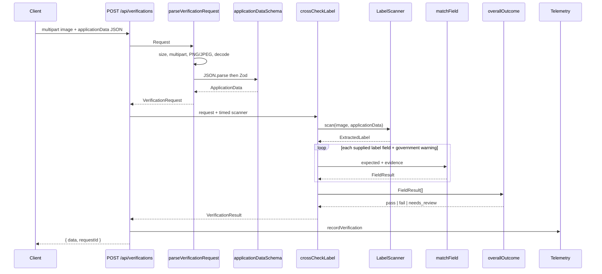
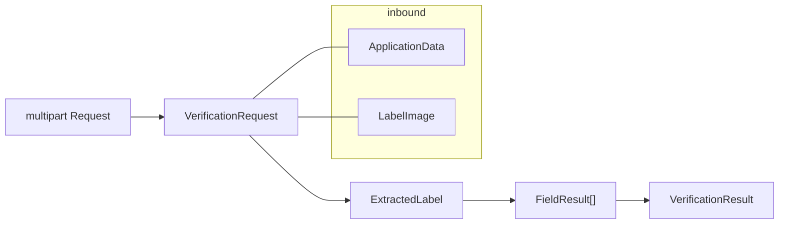
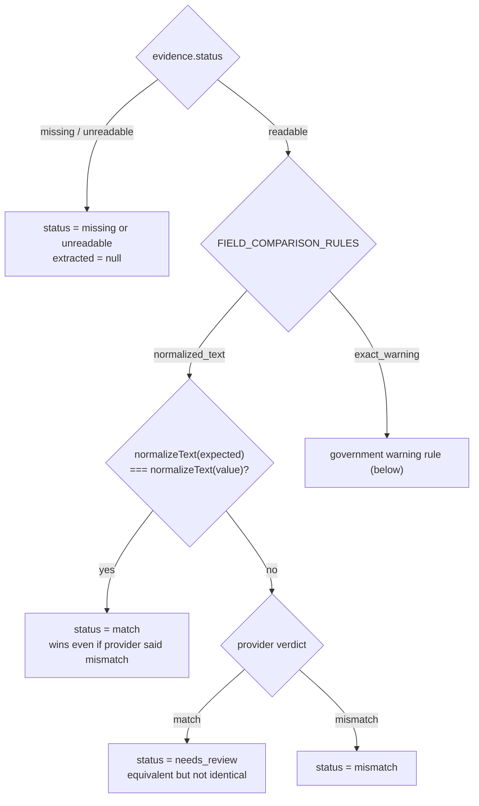

# Architecture

This document covers the server-side design: how a request flows through the code, where validation and the TTB rules live, and how the AI provider is kept at arm's length. For what the app does and how to use it — including the browser UI and batch mode — start with the [README](README.md). The UI only ever calls the one verification endpoint described here, so everything below applies to single and batch runs alike.

The server is stateless: it compares one label image against one application's data, returns a structured verdict, and keeps nothing. Uncertain results are routed to human review.

## Layers

The code is split into three layers, and dependencies only point inward: adapters know about use cases, use cases know about domain types, and the domain imports nothing outside `domain/`. That is what keeps the moving parts swappable — the AI provider, the HTTP handling, and the logging can each change without touching a rule.

| Layer             | Responsibility                                                                                      | Files                                                                                                                                         |
| ----------------- | --------------------------------------------------------------------------------------------------- | --------------------------------------------------------------------------------------------------------------------------------------------- |
| HTTP adapter      | Parse requests, assign request IDs, shape success/error responses, wire the pieces together         | `app/api/verifications/route.ts`, `app/api/health/route.ts`, `server/verification-request.ts`, `server/http.ts`                               |
| Use case          | Run one verification end to end; knows nothing about HTTP or any vendor                             | `usecases/cross-check-label.ts`                                                                                                               |
| Ports             | The two interfaces the use case depends on, free of any technology choice                           | `usecases/ports/label-scanner.ts`, `usecases/ports/telemetry.ts`                                                                              |
| Scanner adapters  | Everything provider-specific: the prompt, the SDK call, reply validation, and the offline stand-ins | `adapters/vision-label-scanner.ts`, `adapters/vision-label-response.ts`, `adapters/stub-label-scanner.ts`, `adapters/unread-label-scanner.ts` |
| Telemetry adapter | One sanitized JSON log line per verification                                                        | `adapters/console-telemetry.ts`                                                                                                               |
| Domain            | The TTB rulebook: types, warning wording, normalizers, field matching, the outcome rule             | `domain/*.ts`                                                                                                                                 |

The route is the only composition point — it decides which `LabelScanner` and `Telemetry` to inject. Production gets `visionLabelScanner` and `consoleTelemetry`; tests inject `stubLabelScanner`, which echoes the application values instead of reading pixels. The route also times the whole request (`durationMs`) and the provider call alone (`scanDurationMs`), so provider latency can be tracked against the roughly five-second usability target. That target is not strictly enforced; the hard abort is the provider's 10-second timeout.

## Request path

Error handling follows one rule: any thrown `PublicApiError` becomes `{ error: { code, message }, requestId }` with its mapped HTTP status, and anything else becomes a generic `INTERNAL_ERROR` (500). Provider failures are translated inside the vision adapter: a timeout becomes `PROVIDER_TIMEOUT` (504), while SDK errors, missing provider configuration, and malformed replies become `PROVIDER_UNAVAILABLE` (503). Stack traces, image bytes, and application data never appear in a response, and telemetry records only the public error code.

## The types, from request to result

- `ApplicationData` — the declared values from the form JSON. `brandName`, `classType`, `alcoholContent`, and `netContents` are required; `producer` and `countryOfOrigin` are optional. `classType` is the class/type designation as printed on the label.
- `LabelImage` — validated in-memory image bytes plus their media type (`image/jpeg` or `image/png`). The untrusted filename is discarded during validation. The type lives on the scanner port so the upload guard and every scanner share one shape.
- `ExtractedLabel` — what a scanner saw, before any rules run. `fields` is a total record: all six keys exist even when the application omitted an optional. `governmentWarning` carries three separate pieces of evidence — heading text, body text, and whether the heading looks bold.
- `JudgedField` — one field's evidence: a status (`readable` / `missing` / `unreadable`), a value only when readable, and — only when readable — the provider's opinion (`match` / `mismatch`). The types make illegal states unrepresentable: a field that was never read cannot carry a value or a verdict. Confidence is categorical (`low` / `medium` / `high`).
- `FieldResult` — one public row: `expected`, `extracted`, `status`, `confidence`, `explanation`. Reported strings are always the originals; normalized copies exist only for comparison and are never returned.
- `VerificationResult` — the overall `outcome` plus the field rows, derived only from statuses and confidences, never from label text directly.

## Where validation happens

Validation is split across three gates because they are three different jobs: the HTTP guard rejects bad requests, the domain schema rejects bad application data, and the vision adapter rejects bad provider replies. By the time `matchField` compares two values, both sides have already been validated.

### 1. Upload guard — `server/verification-request.ts`

Runs before the use case and before any scanner. Failures throw `RequestValidationError`, which maps to public HTTP codes:

| Check                                                          | Failure                        |
| -------------------------------------------------------------- | ------------------------------ |
| `Content-Type` is `multipart/form-data`                        | `UNSUPPORTED_MEDIA_TYPE` (415) |
| Body size vs `MAX_REQUEST_BYTES` (default: image limit + 1 MB) | `PAYLOAD_TOO_LARGE` (413)      |
| Exactly one `image` file and one `applicationData` text field  | `INVALID_REQUEST` (400)        |
| Extension `.png` / `.jpg` / `.jpeg`, MIME matches extension    | `UNSUPPORTED_MEDIA_TYPE`       |
| File size vs `MAX_IMAGE_BYTES` (default 10 MB); empty files    | 413 / 400                      |
| PNG/JPEG magic bytes match the declared type                   | `UNSUPPORTED_MEDIA_TYPE`       |
| Full decode via sharp, 25-megapixel cap                        | `INVALID_REQUEST`              |

### 2. Application data — `domain/application.ts`

The guard JSON-parses the `applicationData` form field and validates it with `applicationDataSchema` (Zod, `strict()`), which lives in the domain so HTTP code and tests share one contract. Strings are trimmed, blanks rejected, and max lengths enforced; unknown keys are rejected. Malformed JSON and schema failures both surface as `INVALID_REQUEST` with no field-level detail.

### 3. Provider output — `adapters/vision-label-response.ts`

`visionOutputFormat` is the structured-output schema sent to Claude. `parseVisionResponse` then enforces the invariants a JSON schema cannot:

- readable evidence must have a non-blank value and a verdict; missing or unreadable evidence must have `value: null` and `verdict: null`
- every field the application supplied must appear exactly once — duplicates are rejected, fields the application never asked about are ignored, and omitted optionals are filled in as `missing` so the record stays total

A reply that fails any of this throws `InvalidVisionResponseError`, which the scanner maps to `PROVIDER_UNAVAILABLE`. It never reaches the matching rules.

## How a field gets its status

`crossCheckLabel` scans the image once, then:

1. For each field the application actually supplied, calls `matchField` with the expected string and the scanner's evidence. Omitted optionals are skipped entirely, so they can never fail a request.
2. Always checks `governmentWarning` — TTB requires it on every label, and its expected wording comes from the versioned `GOVERNMENT_WARNING_RULE`, not from the application.
3. Folds the results into one outcome with `overallOutcome`.

**Text fields** (all six application-backed fields): both sides go through `normalizeText`, which folds case and accents, turns punctuation into spaces, and collapses whitespace — no unit conversion. If the strings are identical after that, the status is `match`, even if the provider disagreed. If they differ, the provider's opinion decides: `match` becomes `needs_review` (equivalent but not identical, so a human confirms), and `mismatch` stays `mismatch`.

**Government warning**: the heading must equal `GOVERNMENT WARNING:` exactly, caps and colon included — `normalizeWarningText` only collapses whitespace. The body must match the standard wording, numbering, and punctuation; `normalizeWarningBody` also lowercases, so letter case and line wrapping are the only tolerated differences. Then:

- either text piece unreadable → `unreadable` (outranks missing)
- both pieces missing → `missing`
- wording wrong → `mismatch`
- wording right, boldness unreadable → `needs_review`
- wording right, heading not bold → `mismatch`
- wording right, heading bold → `match`

The warning row's `expected` / `extracted` join heading and body with one space, and its confidence is the lowest among the evidence pieces involved. For every field, `explanation` is `null` on `match` and a fixed sentence otherwise.

**Overall outcome** (`domain/overall-outcome.ts`): each field maps to `pass` (`match`), `fail` (`mismatch`, `missing`), or `needs_review` (`needs_review`, `unreadable`) — except that a `low`-confidence field always counts as `needs_review` whatever its status, so a shaky reading can never decide the result. The most severe outcome wins (`fail` > `needs_review` > `pass`), and an empty field list is `needs_review`.

## The three scanners

All implement `LabelScanner.scan(image, application) → ExtractedLabel`. Absent or illegible text is evidence (`missing` / `unreadable`), not an error; a rejected promise means the provider itself failed.

| Adapter              | Role                                                                                                                                                                                                                            |
| -------------------- | ------------------------------------------------------------------------------------------------------------------------------------------------------------------------------------------------------------------------------- |
| `visionLabelScanner` | The live one. Sends the image, the expected values, and a prompt to Claude; the structured reply is validated by `parseVisionResponse`. 10-second timeout, one retry, provider failures mapped to the public error codes above. |
| `stubLabelScanner`   | For tests. Echoes application values back as readable matches, with the correct bold warning by default; per-field overrides force any other evidence.                                                                          |
| `unreadLabelScanner` | Offline fallback used in tests. Ignores the image and reports every field unreadable at `low` confidence, which lands on `needs_review`.                                                                                        |

